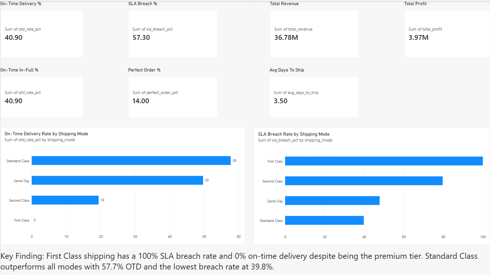
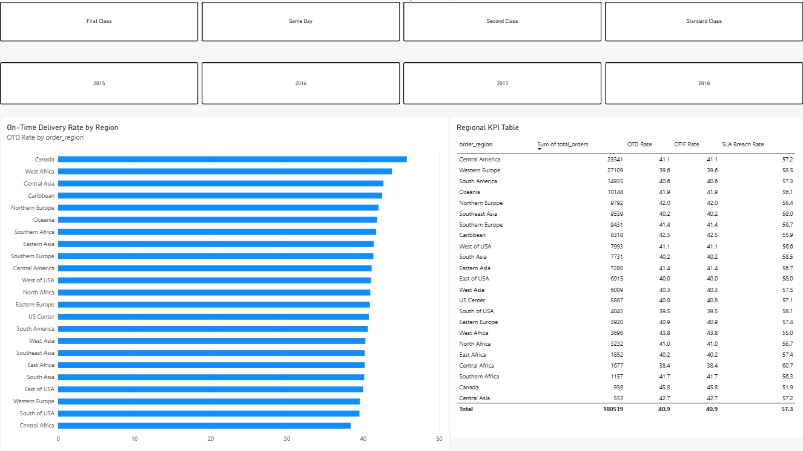
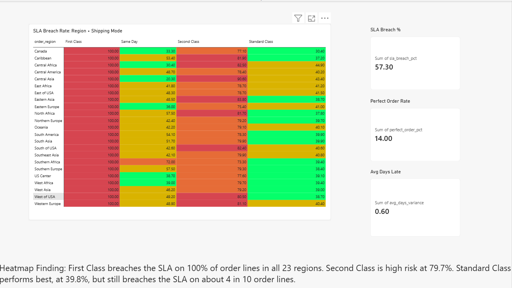
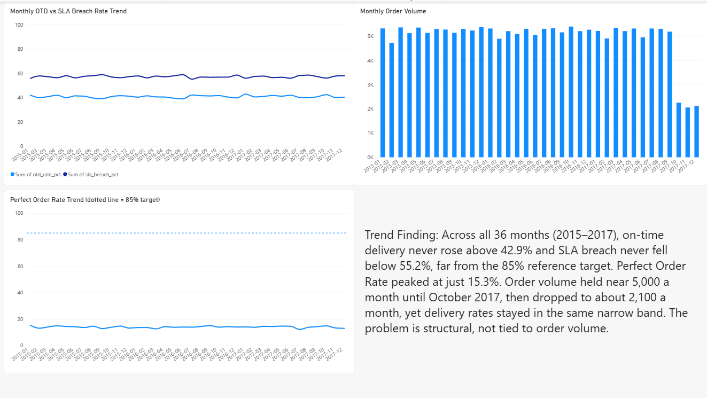

# Supply Chain & Logistics Performance Dashboard

**Python → MySQL → Power BI.** An end-to-end analysis of delivery performance across 180,519 order lines and $36.8M in sales.



---

## The question

Orders ship all over the world, but are they arriving when promised? Which shipping modes and regions are failing, and is it getting better or worse over time?

This project cleans a public shipping dataset, models it as a star schema in MySQL, and answers those questions in a four-page Power BI dashboard.

---

## Key findings

| # | Finding | Evidence |
|---|---|---|
| 1 | Fewer than half of order lines arrive on time | 40.9% on-time delivery. 57.3% break the promised shipping window. Only 14.0% are "perfect". |
| 2 | First Class is the worst shipping mode | 0% on time and 100% SLA breach across 27,814 order lines (about $5.7M in sales). It promises 1 day and averages 2. |
| 3 | Standard Class is the best mode, but still weak | 57.7% on time and 39.8% SLA breach, on 59.7% of all order lines. |
| 4 | Shipping mode matters far more than region | On-time rate ranges from 0% to 57.7% across modes, but only from 38.4% to 45.8% across the 23 regions. |
| 5 | Lowest-performing regions | Central Africa (38.4% on time) and South of USA (39.5%). |
| 6 | The problem is persistent | Over 36 months (2015–2017), on-time rate never exceeded 42.9%, SLA breach never fell below 55.2%, and perfect orders peaked at 15.3%. |

### Performance by shipping mode

| Shipping mode | Order lines | Share | On time | SLA breach | Avg days promised / actual | Sales |
|---|---:|---:|---:|---:|---:|---:|
| First Class | 27,814 | 15.4% | 0.0% | 100.0% | 1 / 2 | $5.67M |
| Second Class | 35,216 | 19.5% | 19.4% | 79.7% | 2 / 4 | $7.15M |
| Same Day | 9,737 | 5.4% | 49.7% | 47.8% | 0 / 0.5 | $1.94M |
| Standard Class | 107,752 | 59.7% | 57.7% | 39.8% | 4 / 4 | $22.02M |

The modes that promise the fastest delivery are the ones that miss their promise most often.

---

## The dashboard

### Page 1: Executive Summary
Seven KPI cards (on-time delivery, on-time in-full, SLA breach, perfect order rate, average days to ship, total sales, total profit) and the on-time and SLA breach rates by shipping mode.


### Page 2: Regional Analysis
On-time rate for each of the 23 regions, a table of regional KPIs, and slicers for year and shipping mode.



### Page 3: SLA Heatmap
SLA breach rate for every region and shipping mode combination (23 × 4). Red is 80% or higher, orange 60–80%, yellow 40–60%, green below 40%. The entire First Class column is red.



### Page 4: Trend Analysis
Monthly on-time and SLA breach rates, order volume, and perfect order rate across the 36 full months (2015–2017).



---

## How it works

```
DataCo CSV (180,519 rows x 53 columns)
   |  Python / pandas: keep 25 columns, fix types, add 12 engineered columns
   v
supplychain_clean.csv (180,519 rows x 37 columns)
   |  MySQL: staging table -> star schema (1 fact + 6 dimensions)
   v
6 reporting views
   |  Power BI: connects to the views
   v
4-page dashboard
```

### Python (`python/`)
The notebook reads the raw file (`cp1252` encoding), keeps the 25 columns the analysis needs, renames them to snake_case, converts dates and numbers to proper types, and adds:
- 5 date parts: year, month, quarter, day of week, and a full-year flag
- 7 KPI columns: `is_on_time`, `is_complete`, `is_qty_fulfilled`, `is_otif`, `is_sla_breach`, `days_variance`, `is_perfect_order`

It exports UTF-8 with LF line endings, which the MySQL load script expects.

### MySQL (`sql/`)

| Script | What it does |
|---|---|
| `01_create_database.sql` | Creates `supplychaindb` |
| `02_staging_table.sql` | Creates `stg_supplychain` (37 columns, mirrors the CSV) |
| `03_bulk_insert.sql` | Loads the CSV with `LOAD DATA LOCAL INFILE` |
| `04_dimension_tables.sql` | Builds the six dimension tables |
| `05_fact_table.sql` | Builds `fact_orders`, one row per order line |
| `06_validation.sql` | Checks the loaded data against the Python output |
| `07_kpi_views.sql` | Creates the six reporting views |
| `08_view_verification.sql` | Confirms every view exists and returns rows |

**Star schema**

| Table | Rows | Notes |
|---|---:|---|
| `fact_orders` | 180,519 | One row per order line, with foreign keys to every dimension |
| `dim_shipping` | 4 | Shipping modes |
| `dim_region` | 23 | One row per region |
| `dim_geography` | 593 | City, state and country only. Region lives in `dim_region`, so the fact-table join cannot multiply rows |
| `dim_product` | 118 | Product, category, department |
| `dim_customer` | 3 | Customer segment |
| `dim_date` | 1,130 | One row per day, 2015-01-01 to 2018-02-03 |

**Reporting views**

| View | Rows | Used for |
|---|---:|---|
| `vw_kpi_summary` | 1 | KPI cards (Page 1) |
| `vw_kpi_by_shippingmode` | 4 | Mode charts (Page 1) |
| `vw_kpi_by_region` | 212 | Regional chart, table and slicers (Page 2) |
| `vw_sla_heatmap` | 92 | Heatmap matrix (Page 3), 23 regions x 4 modes |
| `vw_monthly_trend` | 36 | Trend charts (Page 4), full years only |
| `vw_kpi_by_category` | 51 | Category breakdown |

### KPI definitions

| KPI | Definition |
|---|---|
| On-Time Delivery (OTD) | Share of order lines whose delivery status is "Advance shipping" or "Shipping on time" |
| On-Time In-Full (OTIF) | On time and full quantity. Equals OTD in this dataset (see notes) |
| SLA breach | Actual shipping days are greater than scheduled shipping days |
| Perfect order | On time, order status COMPLETE, and no SLA breach |
| Average days to ship | Mean actual shipping days (3.5) |
| Days variance | Actual minus scheduled shipping days (average +0.6) |

---

## Data notes and limitations

- **Rates are per order line, not per order.** The 180,519 rows are order line items belonging to 65,752 distinct orders.
- **OTIF equals OTD.** The dataset has no field for quantity shipped versus quantity ordered, so `is_qty_fulfilled` is set to 1 for every row. That makes OTIF mathematically identical to OTD (40.9% for both). It is kept for completeness, but it is not an independent measure here.
- **OTD and SLA breach use different definitions.** OTD is based on delivery status and SLA breach on days, so the two do not add up to 100%.
- **2018 is partial.** It has only 2,123 order lines (through 31 January 2018), so trend charts use the 36 full months of 2015–2017.
- **Order volume dropped in late 2017.** Monthly volume held between about 4,900 and 5,350 order lines until September 2017, then fell to 2,255, 2,055 and 2,124 in October to December. The data cannot explain why. On-time and breach rates stayed in the same range throughout.
- **Percentages cannot be summed.** `vw_kpi_by_region` has one row per region, year and shipping mode, so Power BI would add percentages together and show values above 100. Page 2 therefore uses weighted-average measures (see below).
- **The 85% reference value** used in some dashboard text and the Page 4 reference line is a target chosen for this project. It is not calculated from the data.
- **Source:** [DataCo Smart Supply Chain for Big Data Analysis](https://www.kaggle.com/datasets/shashwatwork/dataco-smart-supply-chain-for-big-data-analysis) on Kaggle. The raw and cleaned CSV files are not in this repository because of their size.

---

## Project structure

```
supply-chain-project/
├── data/
│   ├── DataCoSupplyChainDataset.csv     (download from Kaggle, not committed)
│   └── supplychain_clean.csv            (created by the notebook, not committed)
├── python/
│   ├── Supply chain - Data Cleaning and EDA.ipynb
│   └── requirements.txt
├── sql/
│   ├── 01_create_database.sql
│   ├── 02_staging_table.sql
│   ├── 03_bulk_insert.sql
│   ├── 04_dimension_tables.sql
│   ├── 05_fact_table.sql
│   ├── 06_validation.sql
│   ├── 07_kpi_views.sql
│   └── 08_view_verification.sql
├── power_bi/
│   └── Supply_Chain_Dashboard.pbix
├── screenshots/
│   ├── page1_executive_summary.png
│   ├── page2_regional_analysis.png
│   ├── page3_sla_heatmap.png
│   └── page4_trend_analysis.png
└── README.md
```

---

## How to reproduce

Built and run on Windows with Python 3.14, MySQL 8.0.46 and Power BI Desktop.

**Prerequisites:** Python 3.8+, MySQL 8.0+ (the scripts use window functions and recursive CTEs), Power BI Desktop, and MySQL Connector/NET (Power BI needs it to offer the MySQL connector).

### 1. Get the data
Download the dataset from Kaggle, extract it, and save `DataCoSupplyChainDataset.csv` into the `data/` folder. Use that exact name.

### 2. Clean it with Python
```powershell
pip install -r python/requirements.txt
```
Open `python/Supply chain - Data Cleaning and EDA.ipynb` (VS Code with the Jupyter extension works well), select your Python kernel, and run all cells. This creates `data/supplychain_clean.csv` with 180,519 rows and 37 columns.

Expected cell output: OTD 40.9%, OTIF 40.9%, SLA breach 57.3%, perfect order 14.0%.

### 3. Build the database
Allow local file loading once:
```powershell
mysql -u root -p -e "SET GLOBAL local_infile = 1;"
```
Open `sql/03_bulk_insert.sql` and replace the path in the `LOAD DATA LOCAL INFILE` line with the full path to your `supplychain_clean.csv`. Use forward slashes.

Run the scripts in order. PowerShell does not support the `<` operator, so pipe each file in:
```powershell
Get-Content sql/01_create_database.sql    | mysql -u root -p
Get-Content sql/02_staging_table.sql      | mysql -u root -p
Get-Content sql/03_bulk_insert.sql        | mysql -u root -p --local-infile=1
Get-Content sql/04_dimension_tables.sql   | mysql -u root -p
Get-Content sql/05_fact_table.sql         | mysql -u root -p
Get-Content sql/06_validation.sql         | mysql -u root -p
Get-Content sql/07_kpi_views.sql          | mysql -u root -p
Get-Content sql/08_view_verification.sql  | mysql -u root -p
```
(In Command Prompt you can use `mysql -u root -p < sql\01_create_database.sql` instead.)

### 4. Check your results
| After script | You should see |
|---|---|
| `03` | 180,519 rows, 65,752 unique orders, 23 regions |
| `04` | `dim_shipping` 4, `dim_region` 23, `dim_geography` 593, `dim_product` 118, `dim_customer` 3, `dim_date` 1,130 |
| `05` | 180,519 fact rows, total sales 36,784,735.01, total profit 3,966,902.97 |
| `06` | OTD 40.9, OTIF 40.9, SLA breach 57.3, perfect order 14, 180,519 records |
| `07` | First Class: 0% on time, 100% SLA breach |
| `08` | Six views with 1, 4, 212, 92, 36 and 51 rows |

If a number differs, stop and fix that step before moving on, because each script builds on the last.

### 5. Build the dashboard in Power BI
1. **Get data → MySQL database.** Server `localhost:3306`, database `supplychaindb`. On the credentials screen use the **Database** tab with your MySQL username and password.
2. Load the six `vw_` views.
3. In `vw_kpi_by_region`, change **`order_year` to Text** so Power BI treats years as labels instead of summing them.
4. **Pages 1, 3 and 4** use fields directly, because those views have one row per group.
5. **Page 2** needs weighted-average measures, because `vw_kpi_by_region` has several rows per region:

```
OTD Rate = DIVIDE(
    SUMX('supplychaindb vw_kpi_by_region',
        'supplychaindb vw_kpi_by_region'[otd_rate_pct] * 'supplychaindb vw_kpi_by_region'[total_orders]),
    SUM('supplychaindb vw_kpi_by_region'[total_orders])
)
```
Create `OTIF Rate` and `SLA Breach Rate` the same way, using `otif_rate_pct` and `sla_breach_pct`. The Total row should then read 40.9, 40.9 and 57.3, matching Page 1.

6. **Heatmap (Page 3):** a matrix of `order_region` by `shipping_mode` showing `sla_breach_pct`, with row and column totals turned off. Add background colour rules using **Number** (not Percent) thresholds: 80–100 red, 60–under 80 orange, 40–under 60 yellow, 0–under 40 green.
7. **Trend charts (Page 4):** sort the x-axis ascending by `year_month` and fix both line chart y-axes to 0–100.

---

## Troubleshooting

| Problem | Fix |
|---|---|
| PowerShell: *"The '<' operator is reserved for future use"* | Use `Get-Content file.sql \| mysql -u root -p` as shown above |
| `mysql` is not recognized | Add `C:\Program Files\MySQL\MySQL Server 8.0\bin` to PATH, then restart VS Code |
| *"Loading local data is disabled"* | Run `SET GLOBAL local_infile = 1;` and add `--local-infile=1` when running script 03 |
| `ModuleNotFoundError` in the notebook | Run `pip install -r python/requirements.txt`, then restart the kernel |
| Power BI says the MySQL connector needs extra components | Install MySQL Connector/NET and restart Power BI |
| Power BI: *"couldn't authenticate with the credentials provided"* | Use the **Database** tab, not Windows |
| Percentages above 100 on Page 2 | Use the weighted-average measures instead of summing the percentage columns |
| Trend chart months appear out of order | Sort the axis ascending by `year_month` |

---

## Author

**Diksha Bhatia**
